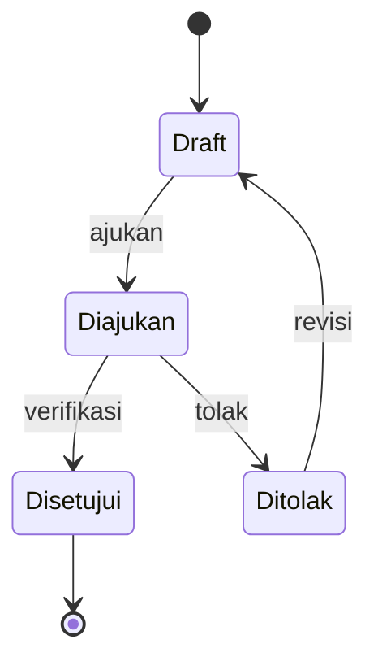
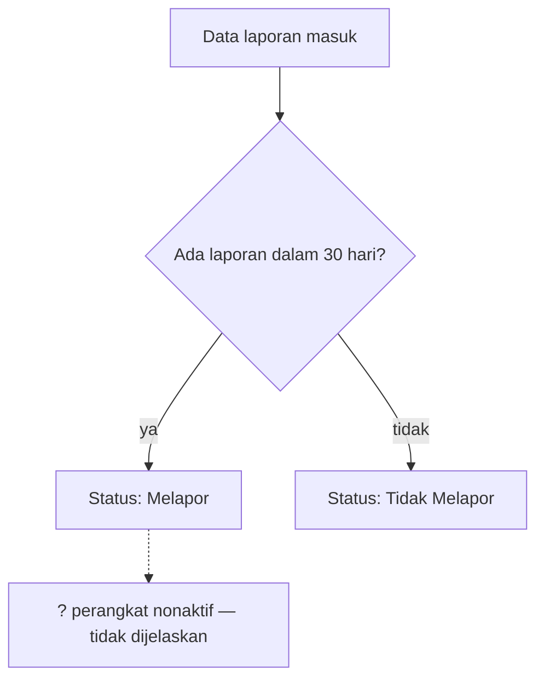

# Flow diagrams

Read this when step 4 found at least one flow in the source.

## Contents
- Detecting a flow
- Picking the diagram type
- Rendering: terminal vs file/page
- Fidelity rules
- Examples

## Detecting a flow
A flow exists when the source describes **order or transitions**, not just a list. Signals:
- Numbered steps, "lalu / kemudian / setelah itu / jika … maka", "step", "tahap", "alur"
- Status/state names with transitions ("Draft → Diajukan → Disetujui", enum status columns, `status = 'X'` updates in code)
- Approval/verification chains with roles ("operator mengajukan, supervisor memverifikasi")
- Request/response between systems (FE → BE → DB, webhook, queue, cron)
- Decision rules (if/else, thresholds, "Tidak Melapor jika …")
- Data pipelines (ingest → transform → store → display)

A plain list of features or a hierarchy is NOT a flow; use a nested list instead.

## Picking the diagram type
| Source describes | Diagram | Mermaid |
|---|---|---|
| Steps with branches/decisions | Flowchart | `flowchart TD` |
| Status lifecycle of one entity | State diagram | `stateDiagram-v2` |
| Messages between systems/actors over time | Sequence | `sequenceDiagram` |
| Steps owned by different roles/units | Swimlane flowchart | `flowchart LR` + one `subgraph` per role |
| Data moving through stages | Pipeline flowchart | `flowchart LR` |

One diagram per flow. If a flow has > ~15 nodes, draw the top level and split sub-flows into separate diagrams.

## Rendering: terminal vs file/page
- **Default (terminal or .md file):** ASCII only, boxes and arrows, max ~80 columns wide, inside a plain code block. No Mermaid.
- **With `--mermaid`:** keep the ASCII and add the Mermaid version in a collapsed `<details>` block below it, for pasting into GitHub, Notion, or mermaid.live.
- **Shareable page (Artifact):** load the `artifact-diagramming` skill and draw inline SVG.

## Fidelity rules
- Every node and every edge comes from the source. Add the locator per diagram (or per edge when steps are spread across sections).
- Use the exact status/step names from the source. Same names as the glossary.
- Edges you inferred but the source doesn't state: dashed (`-.->` in Mermaid, `- - >` / `⋯>` in ASCII) and listed under "Belum jelas". Dashed means inferred only: stated failure/retry paths stay solid with a label. `stateDiagram-v2` has no dashed transitions, so append `(inferensi)` to the label instead.
- Decision chains: if the source gives the conditions but not the order they are checked, draw them in source order and add "urutan cek tidak disebut sumber" under the diagram.
- Every outcome of a decision must be followed to where it goes next. If the source routes several outcomes onward (e.g. all `skipped` reasons into the reminder), draw an edge from each one, not just the first.
- Show missing branches explicitly: a decision with only a "ya" path gets a `? (tidak dijelaskan)` node.
- Terminal states (selesai, ditolak, dibatalkan) must be visible. A state with no exit that isn't terminal is an open question.
- Under each diagram, add 1–3 lines: what triggers the flow, who/what moves it forward, where it ends.

## Examples

**State lifecycle (ASCII default; the `<details>` block appears only with `--mermaid`)**

```
 [Draft] --ajukan--> [Diajukan] --verifikasi--> [Disetujui]
                         |
                         +--tolak--> [Ditolak] --revisi--> [Draft]
```
Pemicu: operator membuat permohonan. Berakhir di Disetujui. (spec.md:§4.2)

<details><summary>Mermaid</summary>


</details>

**Decision rule with a missing branch (`--mermaid` form)**


